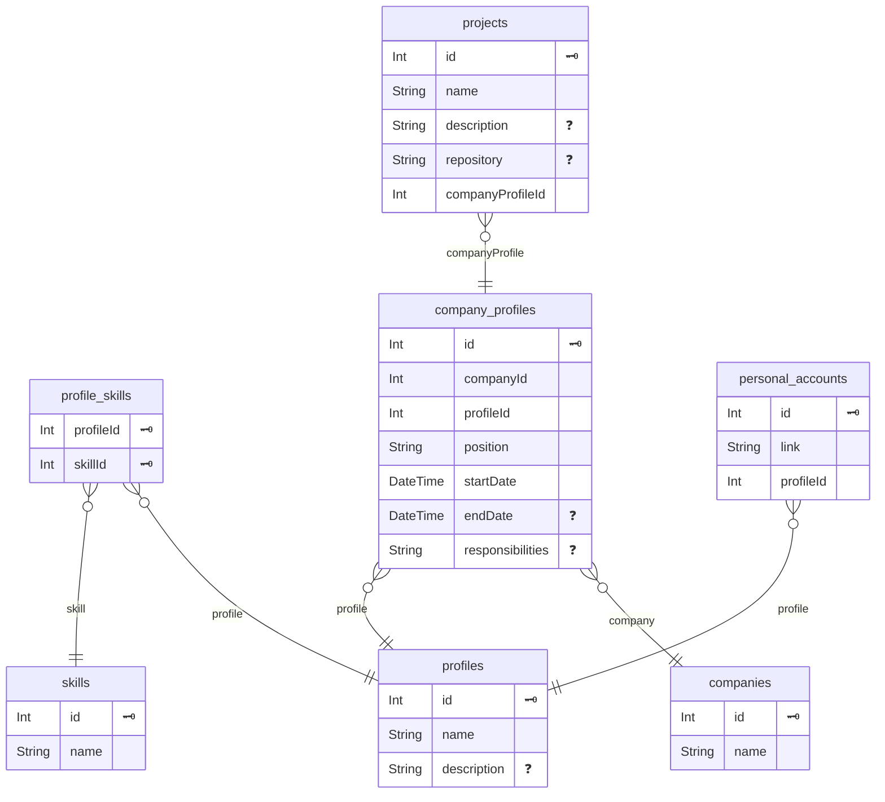

# Тестовое задание

Мини-приложение на базе NestJS и GraphQL, предоставляющее read-only-доступ к данным через GraphQL Sandbox от Apollo.

# Demo

https://test-uwsb.onrender.com/graphql

# Описание

- **Слой данных:** SQLite (для простоты развёртывания) через ORM Prisma.
- **Сетевой слой:** NestJS с GraphQL.

Для сокращения количества запросов к БД и решения проблемы N+1 реализованы request-scoped сервисы с DataLoader ([`profiles-dataloader.service.ts`](src/domains/profiles/profiles-dataloader.service.ts)). Они объединяют множество однотипных запросов к БД в один и кешируют результаты (в пределах одного GraphQL-запроса).

Для чистоты кода dataloader-сервисов добавлены две утилитарные функции — фабрики DataLoader ([`dataloader-fabric.ts`](src/utils/dataloader-fabric.ts)): для загрузки одиночных сущностей и загрузки групп сущностей.

Для упрощения контроля количества SQL-запросов, выполняемых в рамках одного GraphQL-запроса, добавлен небольшой сервисный класс [`PrismaQueryCounter`](src/prisma/prisma-query-counter.ts), работающий на базе `AsyncLocalStorage` Node.js. Инициализация нового асинхронного контекста происходит в [middleware](src/middlewares/query-counter/query-counter.middleware.ts) NestJS.

## Итоговый поток данных:

`Запрос → GraphQL Resolver → request-scoped DataLoader-сервис → Prisma → SQLite`

## Схема базы данных

